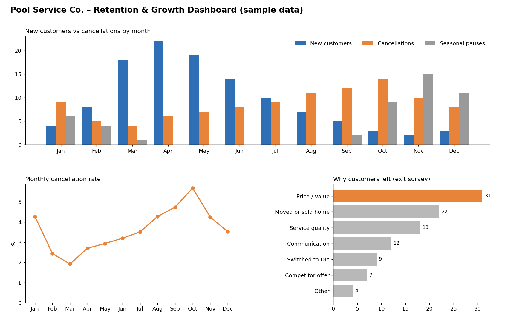

# Customer Retention & Growth Analytics for a Pool Service Company

A data analytics project that turns a small service business's spreadsheets into a live retention dashboard. It includes a business proposal, defined metrics, a Google Sheets data model, and a Grafana dashboard that refreshes automatically as the team enters data.

> **Note:** The company has been anonymized, and every number in this repository is **sample data** created for demonstration. No real customer information is included.



## Business problem

A pool and spa service company wanted to grow in 2027 but had no consistent way to see why customers cancelled, whether retention efforts worked, or how much supply stock sat on each service truck. Records lived in separate spreadsheets, and winter service pauses were easy to confuse with real cancellations.

## Approach

The work is planned in five phases (full detail in [`docs/proposal.pdf`](docs/proposal.pdf)):

1. **Define the questions:** agree on the business questions, review period, and what success means.
2. **Review available data:** confirm which customer, cancellation, pricing, revenue, and supply records exist.
3. **Organize and analyze:** clean and categorize data and calculate baselines, without treating correlation as causation.
4. **Develop recommendations:** compare actions by benefit, cost, effort, and risk.
5. **Pilot and measure:** test one or two ideas on a small scale against a defined baseline.

The proposal groups eight research areas into three themes: retention (cancellation drivers, retention practices, satisfaction survey, exit survey and win-back), growth (loyalty, referrals, employee incentives), and operations (vehicle-level inventory control).

## Key metrics

| Metric | Formula |
| --- | --- |
| Cancellation rate | Cancellations in period ÷ active customers at start of period |
| Retention rate | (Active at end − new customers in period) ÷ active at start |
| Seasonal pauses | Count of customers paused in period, **tracked separately from cancellations** |
| Referral conversion | Referred customers who sign up ÷ qualified referrals |
| Contribution per customer | Revenue − direct service costs, per customer |
| Inventory variance | Recorded stock − counted stock, per vehicle and item |
| Win-back rate | Former customers who return ÷ former customers contacted |

The full list of 12 metrics is in the proposal.

## Architecture

```
Google Sheets (data entry)  ──►  Grafana Google Sheets data source  ──►  Grafana dashboard
  • Monthly Customers              • service account, read-only           • 6 KPI stats
  • Exit Reasons                   • 5-minute cache                       • monthly bar chart
  • Vehicle Inventory                                                     • cancellation-rate trend
                                                                          • exit reasons ranking
                                                                          • stock vs minimum table
```

All calculations (totals, net change, cancellation rate, below-minimum status) are done with Grafana transformations, so the sheet only holds raw inputs and stays easy for non-technical staff to fill in.

## Data model

| Tab | One row means | Columns |
| --- | --- | --- |
| Monthly Customers | One calendar month | `month` (YYYY-MM, stored as text), `active_start`, `new_customers`, `cancellations`, `seasonal_pauses` |
| Exit Reasons | One cancellation reason | `reason`, `customers` |
| Vehicle Inventory | One item on one vehicle | `vehicle`, `item`, `unit`, `on_hand`, `min_level` |

Sample files for each tab are in [`data/`](data/).

## Repository contents

```
├── README.md
├── docs/proposal.pdf          Project proposal (anonymized)
├── data/                      Sample CSVs matching the Google Sheet tabs
├── grafana/dashboard.json     Importable Grafana dashboard
└── images/                    Dashboard preview built from the sample data
```

## How to reproduce

1. Create a Google Sheet with the three tabs and column headers above, and load the sample CSVs.
2. In Google Cloud, enable the **Google Sheets API** and **Google Drive API**, create a service account, and download its JSON key. Never commit this key.
3. Share the sheet with the service account's email as **Viewer**.
4. In Grafana, install the **Google Sheets** data source plugin and configure it with the JSON key (Google JWT File).
5. Import `grafana/dashboard.json`, select the data source, and replace `YOUR_SPREADSHEET_ID` in each panel query with your sheet's ID.

## Lessons learned

- **Seasonal pauses are not churn.** Counting winter pauses as cancellations would inflate the cancellation rate every fall, so they get their own column and metric.
- **Formatted empty rows become data.** Applying a text format to a whole column made the Grafana plugin return almost 1,000 empty rows, which blanked out the charts. Every panel now filters out rows with an empty key column before calculating.
- **Date formats must be consistent.** The trend chart converts `YYYY-MM` text into dates; a value like "January" cannot be parsed, so the data-entry instructions require a fixed format.
- **Keep the sheet simple.** Raw inputs in the sheet and calculations in the dashboard made data entry easier and the formulas easier to audit.

## Known issues

- In my Grafana Cloud setup, the grouped bar chart panel did not render with the Google Sheets source even though the panel received the correct rows. The preview image above was created separately from the sample data. A planned fix is to switch that panel to a time series drawn as bars.

## Tools

Google Sheets · Google Cloud (service account, Sheets and Drive APIs) · Grafana Cloud · Python (pandas, matplotlib, reportlab) for the preview image and PDF

## Author

**Arturo Alvarez**, Junior Data Analyst
